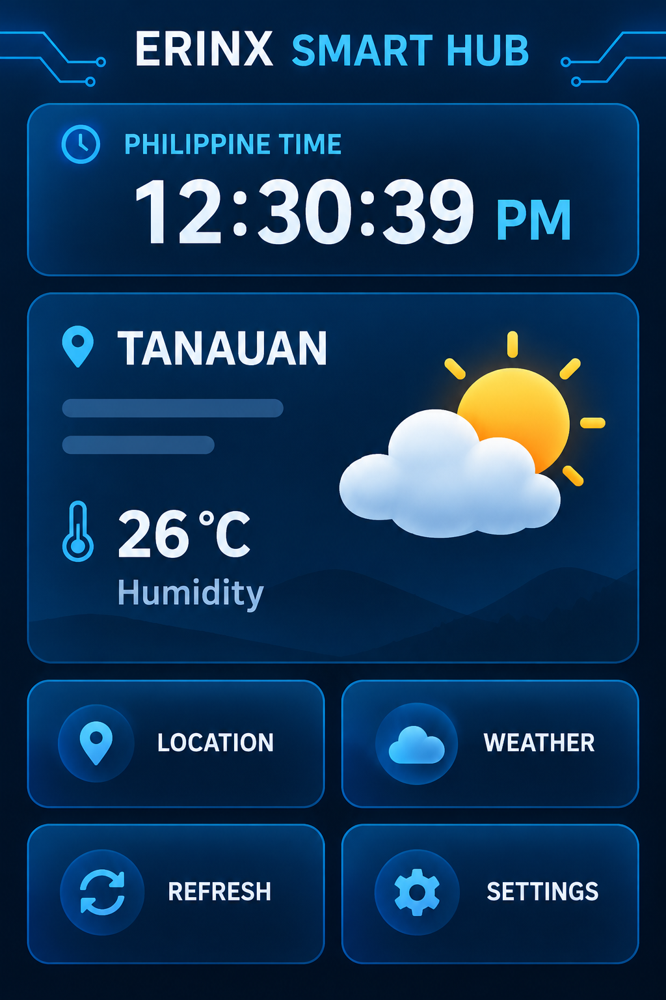

# ERINX Smart Hub

An ESP32-S3 touchscreen dashboard for weather, clock, indoor climate, photo viewing, silent video playback, and local wireless media management.

> **Current release:** V5.2 Wireless File Manager 
> **Target hardware:** ESP32-S3 CAM N16R8, 3.5-inch 320x480 ILI9488/XPT2046 SPI touchscreen, DHT11, and built-in microSD 
> **Project status:** source organized and statically reviewed; final Arduino compile and physical-device regression test still need to be recorded

## Highlights

- Six-page touch interface: Weather, Clock, DHT11, Gallery, Video, and Settings.
- Open-Meteo weather for four Batangas locations with saved city selection.
- Philippine network time with an uptime fallback.
- Local DHT11 temperature and humidity readings.
- JPG gallery and custom silent `.evm` video playback from microSD.
- On-device Wi-Fi scanning and touchscreen password entry.
- Responsive local web file manager for uploading, browsing, and deleting media without removing the SD card.
- Desktop utilities for converting photos and MP4 files into device-compatible formats.

## Quick start

1. Open [`firmware/final/ERINX_Smart_Hub_V5_2/ERINX_Smart_Hub_V5_2.ino`](firmware/final/ERINX_Smart_Hub_V5_2/ERINX_Smart_Hub_V5_2.ino) in Arduino IDE.
2. Keep `FileManager.h`, `FilePortal.h`, and `PageTypes.h` beside the `.ino` file.
3. Select **ESP32S3 Dev Module**, **16 MB flash**, and **OPI PSRAM**.
4. Install the required libraries listed below.
5. Use the verified TFT_eSPI configuration from [`hardware/configs/`](hardware/configs/).
6. Copy the contents of [`sd_card/COPY_TO_SD_ROOT/`](sd_card/COPY_TO_SD_ROOT/) to the root of a FAT32 microSD card.
7. Verify, upload, calibrate touch if prompted, and connect to a 2.4 GHz Wi-Fi network from Settings.
8. Reopen Settings and visit the displayed local `http://` address from a device on the same network.

For detailed V5.2 setup and operational notes, see [`docs/releases/V5.2.md`](docs/releases/V5.2.md).

## Dependencies

Install these through Arduino Library Manager:

- [TFT_eSPI](https://github.com/Bodmer/TFT_eSPI)
- [TJpg_Decoder](https://github.com/Bodmer/TJpg_Decoder)
- ArduinoJson 7
- DHT sensor library by Adafruit
- Adafruit Unified Sensor

WiFi, WebServer, Preferences, FS, HTTPClient, and SD_MMC are supplied by the Espressif ESP32 Arduino core.

## Repository layout

| Path | Purpose |
|---|---|
| `firmware/final/ERINX_Smart_Hub_V5_2/` | Recommended firmware with wireless media management |
| `firmware/final/ERINX_Smart_Hub_V5_1_3_UI_Controls/` | Previous stable UI release without the web file manager |
| `firmware/development/` | Preserved ESP32D and ESP32-S3 development milestones |
| `firmware/diagnostics/` | Display, touch, SDMMC, and FPS benchmark sketches |
| `hardware/configs/` | Reference TFT_eSPI configurations |
| `sd_card/COPY_TO_SD_ROOT/` | Deduplicated icons, sample photos, and EVM video |
| `tools/photo_converter/` | Batch conversion to baseline JPEG |
| `tools/video_converter/` | MP4-to-EVM conversion utility |
| `assets/` | Dashboard mockups, icon sources, and web UI previews |
| `docs/` | Hardware setup, development history, release notes, and test checklist |

## Release overview

| Version | Main addition | Location |
|---|---|---|
| V5.2 | Local responsive wireless file manager | `firmware/final/ERINX_Smart_Hub_V5_2/` |
| V5.1.3 | Wi-Fi password SHOW/HIDE and improved city selector | `firmware/final/ERINX_Smart_Hub_V5_1_3_UI_Controls/` |
| V5.1.2 | SDMMC target checks and board diagnostic | `firmware/development/` and `firmware/diagnostics/` |
| V5.0 | Silent EVM video player | `firmware/development/ESP32S3/` |
| V4.9 | JPEG photo gallery and slideshow | `firmware/development/ESP32S3/` |
| V4.x | ESP32-S3 migration, icons, and UI refinements | `firmware/development/ESP32S3/` |
| V1-V3 | Display, touch, weather, and dashboard prototypes | `firmware/development/ESP32D/` |

The original folder-by-folder packages remain in [`../TFT project/`](../TFT%20project/) as a development archive. New users should start from this organized directory.

## Media formats

- **Photos:** baseline JPG/JPEG; 320x480 is recommended.
- **Videos:** custom silent `.evm` containers generated by `tools/video_converter/convert_videos.py`.
- **Not supported directly:** MP4 playback, progressive JPEG, and PNG display.

Do not copy the `sd_card` directory itself to the card. Copy the `icons`, `photos`, and `videos` folders inside `COPY_TO_SD_ROOT` to the card root.

## Security and limitations

- The file manager is intended for a trusted home, school, or hotspot LAN. It uses local HTTP, not HTTPS.
- Do not expose the ESP32 web server to the public internet or configure router port forwarding for it.
- The access PIN changes at boot and is shown only on the physical Settings screen.
- Saved Wi-Fi credentials live in ESP32 Preferences/NVS without an additional application-level encryption layer.
- Open-Meteo HTTPS currently uses `WiFiClientSecure::setInsecure()`; certificate validation should be added before production deployment.
- The video format is silent, and the camera module is not used for image capture.

## Documentation

- [Hardware and setup](docs/HARDWARE_AND_SETUP.md)
- [Development versions](docs/DEVELOPMENT_VERSIONS.md)
- [V5.2 release guide](docs/releases/V5.2.md)
- [Testing checklist](docs/TESTING_CHECKLIST.md)
- [Source-file manifest](docs/SOURCE_FILE_MANIFEST.csv)
- [Changelog](CHANGELOG.md)

## Author

**Carl Jayson Eli B. Bonaobra** 
CPE4A — Embedded Systems Mini Project

No license has been selected yet. Until a license is added, normal copyright restrictions apply.
